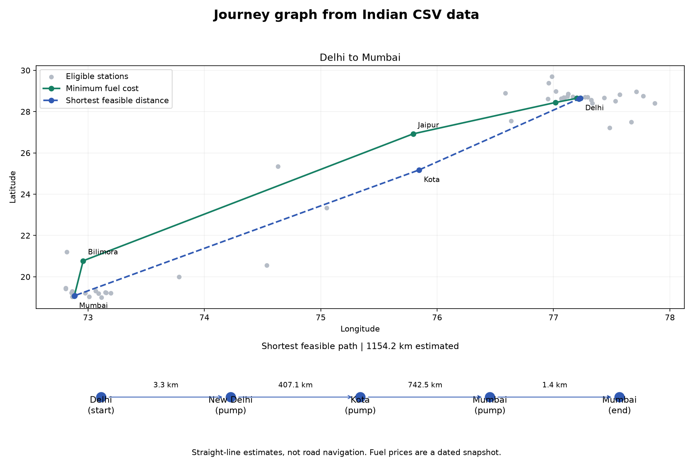

JAYPEE INSTITUTE OF INFORMATION TECHNOLOGY, NOIDA

B.TECH V SEMESTER

REPORT FOR PBL

OPTIMIZATION METHODS &amp; APPLICATIONS

(26B12MA312)

Indian Fuel Journey Planning Using Dynamic Programming

Submitted by

Group: ____________________

Group Head: ________________________________________

| S.No. | Enrolment No. | Mobile | Name | Batch |

| --- | --- | --- | --- | --- |

| 1 |  |  |  |  |

| 2 |  |  |  |  |

| 3 |  |  |  |  |

| 4 |  |  |  |  |

| 5 |  |  |  |  |

**Under the Supervision of:** Dr. Anjali Department of Mathematics JIIT, Sector 62, Noida

--- PAGE BREAK ---

## 1. Objective

Build an interactive Indian journey planner that asks for source, destination and vehicle details, then minimizes fuel purchase cost using CSV station data. Demonstrate Bellman's principle, forward and backward recursion, shortest-path DP, and fuel inventory allocation under tank and reserve constraints.

## 2. Introduction

A traveller needs to decide where to buy fuel and how much to carry. Different station prices make minimum distance and minimum cost different objectives. This terminal-only Python application uses actual Indian city names, station coordinates and dated prices rather than preset routes. It is inspired by Fuel Route Optimizer [1] and applies finite-state DP [2].

## 3. Problem definition

The input catalogue contains 300 distinct Indian pumps [3], with petrol and diesel prices in INR/L, capture dates and source URLs. GeoNames supplies city coordinates and aliases [4]. The application prompts for cities, fuel type, tank capacity, mileage, starting fuel, arrival reserve and corridor width. No journey, station price or vehicle value is fixed in the application code.

S and T are the requested city coordinates. Candidate pumps lie within the chosen geographic corridor and are ordered by forward progress. Edges join later nodes only, forming a directed acyclic graph (DAG). Haversine distances are straight-line estimates; they do not describe a drivable road network. No fuel may be bought at a city coordinate unless the plan reaches a listed pump.

**Mathematical model.** Choose an S-to-T path and purchases q to minimize J = &#8721; puqu. Fuel states use units of 0.5 L; pu is the INR price per unit, half the CSV price per litre. For distance d and mileage e, leg demand is ruv = ceil(duv / (0.5e)). At arrival state (u,f), 0 &#8804; q &#8804; C &#8722; f, f + q &#8805; ruv, and next fuel is g = f + q &#8722; ruv. At S, q = 0; at T, f must meet the requested reserve.

Starting fuel is already owned and excluded from every cost comparison. Prices are deterministic snapshots, not live quotations. Tolls and travel time are excluded. Rounding demand upward is conservative within the geographic model; the guarantee concerns the sampled, forward-only, discretized graph, not an actual road journey.

--- PAGE BREAK ---

## 4. Methodology

## Bellman principle of optimality

From an arrival state (u,f), an optimal journey must have an optimal continuation. Otherwise replacing its remaining plan with a cheaper feasible continuation would reduce total cost, contradicting optimality [2]. Node and fuel determine future choices, while purchase costs add. A node-only state would lose fuel inventory and is insufficient.

## Forward recursion relation

F(u,f) is minimum expenditure already incurred when arriving at u with f fuel units. Initialize F(S,f0) = 0 and every other entry to infinity. In topological order, enumerate feasible purchase and travel decisions, with g = f + q &#8722; ruv:

**F(v,g) &#8592; min {F(v,g), F(u,f) + puq}.**

The optimum is min F(T,f) over terminal fuel meeting the reserve. Save the predecessor state and purchase whenever a value improves, then backtrack to recover the actual journey.

## Backward recursion relation

V(u,f) is minimum future purchase cost. Initialize V(T,f) = 0 for sufficient reserve, and infinity otherwise. Process nodes in reverse topological order:

**V(u,f) = minfeasible (v,q) {puq + V(v, f + q &#8722; ruv)}.**

A state without a feasible continuation has value infinity. The program saves minimizing actions as a backward policy and checks that V(S,f0) equals the forward optimum. Purchases distribute limited tank capacity across stations: carrying cheaper fuel can reduce expensive purchases later while preserving fuel balance.

## Shortest path and implementation

For distance, L(S) = 0 and L(v) = min(u,v) {L(u) + duv}. Backward values satisfy H(T) = 0 and H(u) = min(u,v) {duv + H(v)}. The algorithm checks L(T) = H(S) and reconstructs the shortest feasible path. Fuel DP is itself a shortest path on expanded states (u,f), weighted by purchase costs.

The implementation separates purchases from travel and uses prefix and suffix purchase passes to evaluate the recursions in O((N + E)C) time and O(NC) memory. Geographic graph construction takes O(N<super>2</super>) distance checks. Distance-only DP takes O(N + E) time. All optimization uses Python's standard library; Matplotlib draws the graph.

--- PAGE BREAK ---

## 4. Methodology continued

## User inputs and computed results

This saved example runs from **Delhi to Mumbai**, using petrol. The traveller enters a 50 L tank, 15 km/L mileage, 10 L initial fuel, 5 L arrival reserve and a 100 km corridor. The generated graph has 53 nodes and 785 feasible edges. Price capture date range is 2026-10-19 to 2026-10-19.

| Strategy | Estimated km | Cost INR |

| --- | --- | --- |

| Shortest path, just enough fuel | 1154.2 | 8059.82 |

| Shortest path, optimal purchases | 1154.2 | 7832.80 |

| Joint path and fuel optimization | 1170.8 | 7702.60 |

Forward and backward optima both equal INR 7702.60. Savings against just-enough buying are INR 357.22. All strategies use the same starting fuel, reserve and rounding convention. Extra distance is judged only through its fuel cost.

**Selected purchase plan**

| City | Arrive L | Buy L | Leave L | Cost INR |

| --- | --- | --- | --- | --- |

| Delhi | 10 | 0 | 10 | 0.00 |

| Karol Bagh | 9.5 | 40.5 | 50 | 4135.86 |

| Gurugram | 48 | 2 | 50 | 206.00 |

| Jaipur | 36 | 13.5 | 49.5 | 1521.32 |

| Bilimora | 0 | 18 | 18 | 1839.42 |

Total purchased fuel is 74 L and modelled arrival fuel is 5 L. The source row has no purchase. The complete leg plan, pump names and identifiers are saved in journey_plan.csv; the table shows at most six legs.

**DP values along the chosen journey**

| Arrival city | Fuel L | F cost INR | V cost INR |

| --- | --- | --- | --- |

| Delhi | 10 | 0.00 | 7702.60 |

| Karol Bagh | 9.5 | 0.00 | 7702.60 |

| Gurugram | 48 | 4135.86 | 3566.74 |

| Jaipur | 36 | 4341.86 | 3360.74 |

| Bilimora | 0 | 5863.18 | 1839.42 |

| Mumbai | 5 | 7702.60 | 0.00 |

F records spending already incurred; V records future spending. Full matrices for every candidate node and fuel level are exported as CSV. The 300-row fuel_plan.csv is the candidate catalogue with corridor and selected flags, not a claim that every pump is a journey stop.

--- PAGE BREAK ---

## 4. Methodology continued

## Shortest path graph

The blue dashed path minimizes estimated distance; the green path minimizes fuel purchase cost. Grey points are eligible stations. The lower directed graph shows shortest-path legs and calculated distances. Both paths are derived from the current user input and CSV data.

## 5. Conclusion

The application accepts Indian journey inputs and reconstructs feasible refuelling decisions with matching forward and backward DP costs. Six tests pass, including independent enumeration on 100 small random DAGs and three Indian journeys. The model demonstrates optimal substructure and scarce fuel inventory allocation. Dated prices, sampled coverage, forward-only paths and straight-line distances limit practical accuracy; verify road distances and current pump prices before travel.

## 6. References

[1] Vinayakula06. Fuel Route Optimizer. <link href="https://github.com/vinayakula06/fuel-optimizer">github.com/vinayakula06/fuel-optimizer</link>.

[2] D. Bertsekas. MIT OCW 6.231, Dynamic Programming and Stochastic Control, 2015, Lectures 2 and 3. <link href="https://ocw.mit.edu/courses/6-231-dynamic-programming-and-stochastic-control-fall-2015/pages/lecture-notes/">ocw.mit.edu, course 6.231</link>.

[3] ForceGT. India Fuel Pumps, BPCL snapshot. MIT license. <link href="https://github.com/ForceGT/india-fuel-pumps">github.com/ForceGT/india-fuel-pumps</link>.

[4] GeoNames. Cities15000 and administrative codes. CC BY 4.0. <link href="https://download.geonames.org/export/dump/">download.geonames.org/export/dump</link>.